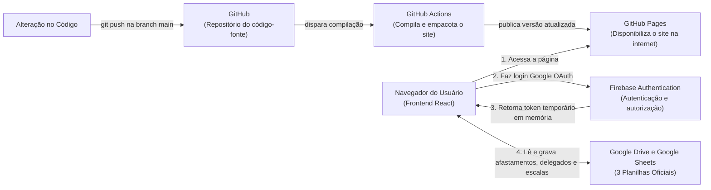

# Escala e Afastamentos — CRPP Joinville

Aplicação web para planejamento, validação automática de afastamentos e gestão completa da **Escala Mensal de Plantão (24x72)** e **Convocações (12h)** da **CRPP Joinville** (**Férias**, **Licença-Prêmio**, **Curso/Convocação** e **Afastamento Médico (LTS/LTF)**), integrada a **três planilhas dedicadas no Google Sheets** por meio da conta Google da unidade, com emissão oficial da escala em **PDF assinado**.

---

## Arquitetura e funcionamento do sistema

Este sistema foi projetado para ser simples de manter, seguro e livre de servidores próprios. Na prática, ele funciona como uma **interface inteligente no navegador** que se conecta diretamente ao **Google Drive / Google Sheets** da delegacia após o usuário fazer login.

### Diagrama de funcionamento



### Papel de cada serviço

| Serviço | Função no sistema |
| --- | --- |
| **GitHub** | Onde o código-fonte do projeto fica armazenado, organizado e versionado (histórico de alterações). |
| **GitHub Actions** | A esteira automática que, a cada alteração enviada para o GitHub, instala as dependências, compila a aplicação e prepara os arquivos finais do site. |
| **GitHub Pages** | O serviço de hospedagem estática que disponibiliza a aplicação na internet para ser acessada pelo navegador, sem necessidade de contratar servidor próprio. |
| **Firebase (Authentication)** | Responsável exclusivamente pela autenticação dos usuários com a conta Google (OAuth 2.0) e pela emissão da autorização temporária para acessar o Google Drive e o Google Sheets. **Não armazena dados da escala.** |
| **Google Sheets (3 Planilhas no Drive)** | Armazenamento oficial dos dados da unidade: (1) **Afastamentos**, (2) **Delegados Convocáveis** e (3) **Escalas Mensais** (uma aba por mês, com salvamento automático por vaga e leitura consolidada ao conectar). |

### Três características essenciais da arquitetura

1. **Execução no navegador (Frontend):** toda a interface, os filtros, os gráficos de cronograma e as regras de verificação de conflitos rodam diretamente no navegador do usuário.
2. **Sem backend próprio:** não existe nenhum servidor intermediário, banco de dados paralelo ou API própria guardando cópias dos afastamentos da delegacia.
3. **Comunicação direta com o Google:** depois do login, o navegador conversa diretamente com as APIs oficiais do Google (`Drive` e `Sheets`) usando a autorização concedida pelo usuário autenticado.

---

### Perguntas frequentes sobre operação, falhas e segurança

- **Onde estão armazenados os dados?**
  Todos os dados reais ficam exclusivamente na planilha do **Google Sheets** escolhida ou criada no **Google Drive** da conta conectada. O código publicado no GitHub contém apenas o programa e uma escala fictícia de exemplo para prévia inicial.

- **Quais informações são públicas e quais permanecem privadas?**
  - **Públicas (no repositório do GitHub):** o código-fonte da aplicação, as regras gerais de validação, os arquivos de compilação e os registros fictícios de demonstração (`src/data/seedFerias2027.ts`), além das chaves públicas de identificação do app necessárias para o navegador iniciar o login com o Google.
  - **Privadas:** os nomes reais dos servidores, datas oficiais, planilhas internas do Google Drive e o token temporário de acesso da sessão (que fica somente na memória do navegador durante o uso e nunca é salvo em disco ou banco externo). Somente usuários que já têm permissão na planilha dentro do Google Drive conseguem lê-la ou editá-la pelo sistema.

- **O que acontece quando uma alteração é feita no código?**
  Quando uma atualização é enviada para a branch `main` no GitHub, o **GitHub Actions** inicia automaticamente um novo build e publica a versão atualizada no **GitHub Pages** em poucos minutos. Os dados que já estão na planilha do Google Sheets não são apagados nem modificados por atualizações no código.

- **Se o GitHub sair do ar, o que acontece?**
  - Se o **repositório GitHub** tiver uma instabilidade, o site já publicado no GitHub Pages geralmente continua acessível, mas novas atualizações de código ficam aguardando.
  - Se o **GitHub Pages** sair do ar, a página do aplicativo não abre temporariamente, porém **nenhum dado é perdido**: a planilha oficial continua intacta e acessível normalmente direto pelo Google Drive / Google Sheets.

- **Se o Firebase deixar de funcionar, o que acontece?**
  O botão de **Entrar com Google** (login OAuth) fica temporariamente indisponível, impedindo novas autenticações para acessar a planilha. O site continua abrindo em modo de prévia local e os dados já salvos no Google Sheets permanecem preservados.

- **Se o Google Sheets (ou Google Drive) ficar indisponível, o que acontece?**
  A interface abre normalmente no navegador, mas não consegue listar, carregar ou salvar alterações na planilha oficial enquanto a instabilidade durar. Quando o usuário tenta gravar ou excluir algum registro nessas condições, a operação é bloqueada com mensagem de erro para evitar divergência com a planilha.

---

## Principais Funcionalidades

- **Múltiplos Tipos de Afastamento:**
  - Suporte nativo a **Férias**, **Licença-Prêmio**, **Curso/Convocação** e **Afastamento Médico (LTS/LTF)**, cada um identificado por cor própria no cronograma, no calendário mensal e nos relatórios exportados.
  - Lançamentos ilimitados por servidor (agrupados automaticamente na linha do servidor na timeline anual).
- **Seção Dedicada para Terceirizados:**
  - Exibição em bloco separado dos servidores policiais (`Alfa`, `Bravo`, `Charlie`, `Delta`, `Volante`, `Coordenação`), sem aplicar regras de conflito da escala policial aos colaboradores terceirizados.
- **Cronograma Anual (Timeline):**
  - Visão de 12 meses por servidor/colaborador, com seletor dinâmico de ano, atalho para adicionar novo afastamento diretamente na linha do servidor e filtros combináveis por **Tipo de Afastamento**, **Equipe**, **Cargo**, **Situação** (`Regulares` / `Conflitos`) e **Busca por nome**.
- **Calendário Mensal:**
  - Grade diária mostrando todos os servidores afastados em cada data do mês selecionado, com destaque visual para conflitos e painel lateral para consulta por dia específico.
- **Motor de Validação Operacional em Cascata:**
  1. **Meses vedados para férias:** bloqueia períodos de **Férias** de servidores policiais que atinjam **Janeiro**, **Fevereiro** ou **Dezembro**. Outros tipos de afastamento (`Licença-Prêmio`, `Curso/Convocação` e `Afastamento Médico (LTS/LTF)`) são permitidos nesses meses.
  2. **Mesmo cargo na mesma equipe:** impede afastamentos coincidentes (de qualquer tipo) entre dois servidores policiais do mesmo cargo na mesma equipe.
  3. **Delegado e Escrivão:** impede que Delegado e Escrivão da mesma equipe coincidam períodos de afastamento (de qualquer tipo).
  4. **Sobreposição própria e consistência de datas:** valida datas de início/término e impede sobreposição entre lançamentos do mesmo servidor.
- **Gestão Assistida com 3 Planilhas no Google Drive:**
  1. **Planilha de Afastamentos** (`Controle_de_Afastamentos_CPP_Joinville`): leitura e gravação de lançamentos a partir da linha 2, com confirmação explícita em modal antes de gravar, atualizar ou excluir registros.
  2. **Planilha de Delegados Convocáveis** (`Delegados_Convocacao_CPP_Joinville`): relação nominal de Delegados (`Nome` e `Delegacia`) utilizada para o preenchimento das vagas de DPC na escala.
  3. **Planilha Exclusiva de Escalas Mensais** (`Escalas_Mensais_CPP_Joinville`): armazena o histórico anual em abas mensais (`Escala Dez-2026`, `Escala Jan-2027`, etc.). Ao conectar ou entrar com o Google, **todos os meses salvos são carregados em lote automaticamente**, e **cada vaga preenchida ou limpa salva automaticamente na aba do mês correspondente**.
- **Módulo de Escala Mensal (24x72) e Convocações (12h):**
  - **Ciclo ininterrupto 24x72**: ancorado oficialmente em `01/12/2026 = Charlie` (`Charlie → Delta → Alfa → Bravo`), com início às 08h00 e término às 08h00 do dia seguinte.
  - **Detecção automática de vacâncias**: cruza os afastamentos do mês de referência para apontar os furos por turno de 12h (`APC - dia/noite` até 2 vagas, `DPC - dia/noite` e `EPC - dia/noite`), considerando a vacância fixa de Delegado da equipe **Delta** e **excluindo servidores terceirizados** da visualização e do cômputo da escala.
  - **Preenchimento ágil**: seleção nominal de Delegados para `DPC` (exibindo delegacia de origem) e seleção entre as 24 delegacias oficiais da regional para `APC` e `EPC`, com opção de replicar automaticamente para os dois turnos de 12h (completar 24h) e destaque cruzado ao clicar em um afastado na barra lateral.
- **Emissão Oficial em PDF com Assinatura Institucional:**
  - Botão **Gerar PDF** abre diálogo para informar o nome do **Delegado Coordenador**, exibe pré-visualização e gera `Escala_<Mes>_<Ano>_CPP_Joinville.pdf` no padrão institucional da CRPP Joinville, com rodapé de horários e regime presencial, data automática à esquerda sem horário (`Joinville, DD/MM/AAAA`) e bloco centralizado (`[NOME]` / `Delegado de Polícia Civil` / `(assinado digitalmente)`).
- **Exportação de Relatórios:**
  - Geração local de arquivos `.csv` (compatível com Excel) e relatórios `.html` autônomos para afastamentos e escala mensal.

---

## Estrutura Esperada na Planilha (Google Sheets)

### Formato padrão (1 lançamento por linha)

A aplicação trata a linha 1 (ou a linha de cabeçalho detectada) como cabeçalho e lê/grava os lançamentos a partir da **linha 2**:

| Coluna | Descrição |
| --- | --- |
| `Equipe` | `Alfa`, `Bravo`, `Charlie`, `Delta`, `Volante`, `Coordenação` ou `Terceirizado` |
| `Servidor` | Nome do servidor ou colaborador |
| `Cargo` | `Delegado`, `Escrivão`, `Agente` ou `Terceirizado` |
| `Tipo de Afastamento` | `Férias`, `Licença-Prêmio`, `Curso/Convocação` ou `Afastamento Médico (LTS/LTF)` |
| `Início` | Data inicial do afastamento (`DD/MM/AAAA` ou `AAAA-MM-DD`) |
| `Fim` | Data final do afastamento (`DD/MM/AAAA` ou `AAAA-MM-DD`) |
| `Dias` | Quantidade de dias corridos (inclusivo) |

> **Compatibilidade:** o leitor também reconhece variações de cabeçalho em português (como `Plantão`, `Setor`, `Policial`, `Função`, `Afastamento`, `Motivo/Categoria`, `Data inicial do Afastamento`, `Data final do Afastamento`), suporta linhas de título antes do cabeçalho e mantém compatibilidade retroativa com planilhas legadas que utilizam 2 períodos na mesma linha (`Início – período 1/2`, `Fim – período 1/2`).

### 2. Planilha de Delegados Convocáveis (`Delegados`)

| Coluna | Descrição |
| --- | --- |
| `Nome` | Nome do Delegado disponível para convocação |
| `Delegacia` | Delegacia/unidade policial de origem |

### 3. Planilha Exclusiva de Escalas Mensais (`Escala <Mês>-<Ano>`)

Cada mês do histórico fica em uma aba própria (`Escala Dez-2026`, `Escala Jan-2027`, etc.) com as colunas `DIA MÊS`, `DIA SEMANA`, `EQUIPE`, `APC - dia`, `APC - noite`, `DPC - dia`, `DPC - noite`, `EPC - dia`, `EPC - noite` e o rodapé institucional padrão na última linha.

---

## Stack Tecnológica

- **Frontend:** React 19, TypeScript, Vite 8, Tailwind CSS v4
- **Geração de PDF:** `jspdf`, `jspdf-autotable`
- **Ícones e Animações:** `lucide-react`, `motion`
- **Autenticação e APIs Google:** Firebase Authentication (Google Provider), Google Drive API v3 e Google Sheets API v4
- **Testes Unitários:** `node:test` + `tsx`

---

## Executando Localmente (Desenvolvedores)

### Pré-requisitos
- Node.js 20+
- npm

### Instalação e desenvolvimento
```bash
npm install --legacy-peer-deps
npm run dev
```
A aplicação ficará disponível em `http://localhost:3000`.

### Scripts úteis
```bash
# Verificação de tipos TypeScript
npm run lint

# Testes unitários (regras operacionais, escala 24x72 e integrações Google Sheets)
npx tsx --test src/utils/validarFerias.test.ts src/services/googleSheetsService.test.ts src/utils/escalaMensalUtils.test.ts src/services/delegadosSheetsService.test.ts src/services/escalaSheetsService.test.ts

# Build de produção
npm run build
```

---

## Deploy no GitHub Pages

O repositório inclui o workflow `.github/workflows/deploy.yml`, configurado para compilar com o caminho base do repositório e publicar automaticamente a cada `push` na branch `main`.

Para ativar em um repositório novo:
1. Em **Settings → Pages**, defina **Source** como **GitHub Actions**.
2. Em **Firebase Console → Authentication → Settings → Domínios autorizados**, garanta que o domínio `*.github.io` utilizado esteja autorizado.
3. No **Google Cloud Console** do projeto vinculado ao `firebase-applet-config.json`, mantenha as APIs **Google Drive API** e **Google Sheets API** habilitadas (e os usuários autorizados na tela de permissão OAuth, caso o app esteja em modo de teste).
